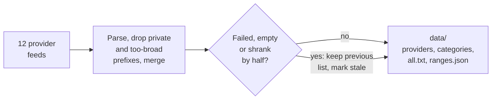

# Datacenter IP ranges

**Cloud, hosting and CDN IP ranges from the providers' own feeds, rebuilt every day, with fast lookup helpers for Node.js and PHP.**

[](https://github.com/moonetix/datacenter-ip-ranges/actions/workflows/ci.yml)
[](https://github.com/moonetix/datacenter-ip-ranges/actions/workflows/update.yml)
[](LICENSE)
[](#nodejs)
[](#php)
[](package.json)
[](https://moonetix.com)
[](https://moonetix.github.io/datacenter-ip-ranges/)

Maintained by [Moonetix](https://moonetix.com).

A sign-up from an AWS address, an offer click from a DigitalOcean droplet, a "user" on a GitHub Actions runner: real people rarely browse from a datacenter. This repo collects the address ranges that AWS, Google Cloud, Oracle Cloud, DigitalOcean, Linode, Vultr, Cloudflare, Fastly and GitHub publish about themselves, merges them into plain CIDR lists, and keeps Tor exits and iCloud Private Relay in separate lists so you can treat them differently.

Every range comes from a feed the provider documents. Nothing is scraped from third-party lists, nothing is guessed from ASN names.

```sh
git clone --depth 1 https://github.com/moonetix/datacenter-ip-ranges
node datacenter-ip-ranges/bin/check.js 3.5.140.1 8.8.8.8 192.168.1.10
```

```text
3.5.140.1     aws                   cloud          3.5.128.0/19
8.8.8.8       google-services       services       8.8.8.0/24
192.168.1.10  not listed
```

To try an address without installing anything, open the [live demo](https://moonetix.github.io/datacenter-ip-ranges/). It runs the same matcher in your browser on the current lists.

Only need the list? `curl -fsSL https://raw.githubusercontent.com/moonetix/datacenter-ip-ranges/main/data/all.txt` gives one CIDR per line.

## Why datacenter traffic matters on rewards traffic

Offerwalls, rewards sites and incentive apps pay users for actions. That makes them a target for scripted farms, which almost always run on rented servers:

- **Advertisers do not pay for it.** Networks and advertisers reject or reverse conversions from hosting networks, so a credited reward from a datacenter IP is often money you pay out and never receive.
- **Sign-up and bonus abuse scales on servers.** One VPS can create hundreds of accounts. A datacenter check at sign-up stops the cheapest version of that.
- **Click and impression spam.** Headless browsers on cloud instances inflate clicks and break your conversion rate data.
- **Cheap to check.** A lookup here takes well under a microsecond in Node.js, so it can run on every request.

A match is a signal, not a verdict. See [Limitations](#limitations).

## The lists

| File | Contents |
| --- | --- |
| [`data/all.txt`](data/all.txt) | Every datacenter range: categories `cloud`, `cdn`, `services`. IPv4 first, then IPv6. One CIDR per line. |
| [`data/ipv4.txt`](data/ipv4.txt), [`data/ipv6.txt`](data/ipv6.txt) | The same, split by family. |
| [`data/providers/<id>.txt`](data/providers) | One provider, for example `aws.txt`, `cloudflare.txt`, `tor.txt`. |
| [`data/categories/<category>.txt`](data/categories) | One category: `cloud`, `cdn`, `services`, `privacy-relay`, `tor`. |
| [`data/ranges.json`](data/ranges.json), [`data/ranges.csv`](data/ranges.csv) | Every provider range with `provider`, `category`, `cidr` and `source` URL. All categories. |
| [`data/sources.json`](data/sources.json), [`data/SOURCES.md`](data/SOURCES.md) | Per feed: status, range counts, last fetch time, feed URL, terms. |

`all.txt`, `ipv4.txt` and `ipv6.txt` do **not** contain Tor exits or iCloud Private Relay. Those carry real users and deserve a different policy. Use `data/categories/tor.txt` and `data/categories/privacy-relay.txt` for them.

Ranges are normalized: host bits cleared, IPv6 in RFC 5952 form, overlapping and adjacent blocks merged, private and documentation ranges removed. A merged block can be larger than any single block in the provider's feed; the set of addresses is the same.

### Categories

| Category | Providers | Typical traffic |
| --- | --- | --- |
| `cloud` | AWS, Google Cloud, Oracle Cloud, DigitalOcean, Akamai Cloud (Linode), Vultr | VPS and cloud instances: bots, scrapers, self-hosted proxies and VPNs |
| `cdn` | Cloudflare, Fastly | Edge networks: requests relayed or sent by code running on the CDN. Cloudflare WARP exits from addresses outside the published ranges, so WARP users are not matched. |
| `services` | Google services (goog.json minus cloud.json), GitHub (incl. Actions runners) | Crawlers, fetchers, CI runners, automation |
| `privacy-relay` | iCloud Private Relay | Safari users on iCloud+. Real people, shared addresses. |
| `tor` | Tor exit nodes | Tor Browser users and automated tools on Tor |

## Raw files

Use the files straight from GitHub. They change only when a provider changes its ranges.

```text
https://raw.githubusercontent.com/moonetix/datacenter-ip-ranges/main/data/all.txt
https://raw.githubusercontent.com/moonetix/datacenter-ip-ranges/main/data/ipv4.txt
https://raw.githubusercontent.com/moonetix/datacenter-ip-ranges/main/data/ipv6.txt
https://raw.githubusercontent.com/moonetix/datacenter-ip-ranges/main/data/providers/aws.txt
https://raw.githubusercontent.com/moonetix/datacenter-ip-ranges/main/data/categories/tor.txt
https://raw.githubusercontent.com/moonetix/datacenter-ip-ranges/main/data/ranges.json
```

Download once a day, not on every request:

```sh
curl -fsSL -o /etc/dcip/all.txt \
  https://raw.githubusercontent.com/moonetix/datacenter-ip-ranges/main/data/all.txt
```

nginx can tag requests with the `geo` module. Rebuild the map after each download:

```sh
sed 's/$/ 1;/' /etc/dcip/all.txt > /etc/nginx/datacenter.map && nginx -s reload
```

```nginx
geo $remote_addr $is_datacenter {
    default 0;
    include /etc/nginx/datacenter.map;
}
# Pass it to your app, for example: proxy_set_header X-Datacenter $is_datacenter;
```

## Node.js

Node 22 or newer, no dependencies. Install from GitHub:

```sh
npm install github:moonetix/datacenter-ip-ranges
```

```js
const { isDatacenterIp, lookup } = require('datacenter-ip-ranges');

isDatacenterIp('3.5.140.1');          // true  (AWS)
isDatacenterIp('::ffff:104.16.0.1');  // true  (Cloudflare, IPv4-mapped form from a dual-stack socket)
isDatacenterIp('192.168.1.10');       // false
isDatacenterIp('not an ip');          // false

lookup('172.224.226.1');  // [ { provider: 'icloud-private-relay', category: 'privacy-relay' } ]
lookup('8.8.8.8');        // [ { provider: 'google-services', category: 'services' } ]
lookup('198.51.100.7');   // []
lookup('nope');           // null
```

`isDatacenterIp()` checks `cloud`, `cdn` and `services`. `lookup()` checks every category and returns all lists that contain the address; Private Relay egress often sits inside Cloudflare or Akamai space, so one address can match more than one list.

For a custom set, build your own matcher. It loads in about 100 ms and is meant to be built once per process:

```js
const { load } = require('datacenter-ip-ranges');

const cloudOnly = load({ categories: ['cloud'] });
const torOrRelay = load({ categories: ['tor', 'privacy-relay'] });
const awsOnly = load({ providers: ['aws'] });
const fromMyCopy = load({ dataDir: '/etc/dcip' });   // a folder with sources.json, providers/

cloudOnly.contains(req.socket.remoteAddress);
torOrRelay.lookup('185.220.101.1');
```

The matcher cuts all ranges into disjoint segments, each with a bit mask of the lists that cover it, and answers with one binary search. Plain IPv4 strings skip the general parser. On a small VPS, one million IPv4 lookups take about 160 ms; IPv6 lookups use `BigInt` and take a few microseconds each.

`createMatcher(lists)` from `datacenter-ip-ranges/matcher` builds a matcher from your own CIDR lists, if you want the same engine for an allow list or your own blocklist.

## PHP

PHP 8.1 or newer, one file, no extensions beyond the standard ones. Clone the repo (or copy `php/` and `data/` side by side) and include the file:

```php
require __DIR__ . '/datacenter-ip-ranges/php/DatacenterIp.php';

if (is_datacenter_ip($_SERVER['REMOTE_ADDR'])) {
    // Hold the reward for review, ask for verification, or skip the bonus.
}

// Other categories or your own copy of the data:
$torOrRelay = DatacenterIp::fromDataDir('/etc/dcip', ['tor', 'privacy-relay']);
$torOrRelay->contains('185.220.101.1');
```

`is_datacenter_ip()` loads the lists once per process. Under PHP-FPM that is once per request, about 25 ms. For busy sites, export once after each download and let OPcache keep the arrays in shared memory:

```php
// After downloading new lists (cron):
DatacenterIp::fromDataDir('/etc/dcip')->exportPhp('/etc/dcip/datacenter.php');

// In the request:
$dc = DatacenterIp::fromPhp('/etc/dcip/datacenter.php');
$dc->contains($_SERVER['REMOTE_ADDR']);
```

## Command line

```sh
node bin/check.js 3.5.140.1 8.8.8.8 192.168.1.10 172.224.226.1
```

```text
3.5.140.1      aws                   cloud          3.5.128.0/19
8.8.8.8        google-services       services       8.8.8.0/24
192.168.1.10   not listed
172.224.226.1  icloud-private-relay  privacy-relay  172.224.226.0/26
```

Options: `--json` for JSON output, `--only cloud,cdn` to limit categories, `--data <dir>` for another copy of the data, `-` to read addresses from stdin. Exit codes follow `grep`: 0 if any address is listed, 1 if none is, 2 for invalid input. Installed from GitHub, the same command is available as `npx datacenter-ip`.

```sh
# Which of yesterday's sign-up IPs came from a datacenter?
cut -d, -f3 signups.csv | node bin/check.js --only cloud,cdn,services - | grep -v 'not listed'
```

PHP has the same check: `php php/check.php 3.5.140.1`.

## Behind a proxy or CDN

Check the address of the visitor, not of your own infrastructure. If your site runs behind Cloudflare, a load balancer or a reverse proxy, the TCP peer is that proxy, and every request matches. Read the client address from the header your proxy sets (`CF-Connecting-IP`, `X-Forwarded-For`, `X-Real-IP`), and trust that header only when the request actually came from your proxy. The `cdn` lists help with the second part:

```js
const cdn = load({ categories: ['cdn'] });
const peer = req.socket.remoteAddress;
const client = cdn.contains(peer) ? req.headers['cf-connecting-ip'] : peer;
```

Do not apply these lists to your postback endpoint. Networks deliver postbacks from their servers, which are datacenter addresses by design. Verify the postback signature instead.

## Sources and terms

Each feed is published by the provider for allow lists, firewalls or geolocation. None of them states a license that forbids redistribution, except Microsoft's Download Center terms, which is why Azure is not in the committed data (see below). Check the terms yourself before you build a commercial product on them.

| Provider | Category | Feed | Documentation | Terms |
| --- | --- | --- | --- | --- |
| Amazon Web Services | cloud | [ip-ranges.json](https://ip-ranges.amazonaws.com/ip-ranges.json) | [AWS IP address ranges](https://docs.aws.amazon.com/vpc/latest/userguide/aws-ip-ranges.html) | Published for filtering and allow lists; no license stated |
| Google Cloud | cloud | [cloud.json](https://www.gstatic.com/ipranges/cloud.json) | [Google IP address ranges](https://support.google.com/a/answer/10026322) | Published for allow lists; no license stated |
| Google services | services | [goog.json](https://www.gstatic.com/ipranges/goog.json) minus cloud.json | [Google IP address ranges](https://support.google.com/a/answer/10026322) | Published for allow lists; no license stated |
| Oracle Cloud | cloud | [public_ip_ranges.json](https://docs.oracle.com/en-us/iaas/tools/public_ip_ranges.json) | [OCI IP address ranges](https://docs.oracle.com/en-us/iaas/Content/General/Concepts/addressranges.htm) | Oracle documentation; no license stated |
| DigitalOcean | cloud | [geo/google.csv](https://www.digitalocean.com/geo/google.csv) | Linked from [DigitalOcean platform docs](https://docs.digitalocean.com/platform/) | RFC 8805 geofeed; no license stated |
| Akamai Cloud (Linode) | cloud | [linode-geofeed.csv](https://ipgeo.akamai.com/linode-geofeed.csv) | Declared in the [ARIN record](https://rdap.arin.net/registry/ip/172.104.0.1) | RFC 8805 geofeed; no license stated |
| Vultr | cloud | [geofeed.constant.com](https://geofeed.constant.com/) | Declared in the [ARIN record](https://rdap.arin.net/registry/ip/45.32.0.1) | RFC 8805 geofeed of AS20473; no license stated |
| Cloudflare | cdn | [ips-v4](https://www.cloudflare.com/ips-v4), [ips-v6](https://www.cloudflare.com/ips-v6) | [Cloudflare IP ranges](https://www.cloudflare.com/ips/) | Published for allow lists; no license stated |
| Fastly | cdn | [public-ip-list](https://api.fastly.com/public-ip-list) | [Fastly API reference](https://www.fastly.com/documentation/reference/api/utils/public-ip-list/) | Public API endpoint; no license stated |
| GitHub | services | [api.github.com/meta](https://api.github.com/meta) | [Meta API](https://docs.github.com/en/rest/meta/meta), [GitHub's IP addresses](https://docs.github.com/en/authentication/keeping-your-account-and-data-secure/about-githubs-ip-addresses) | [GitHub Terms of Service](https://docs.github.com/en/site-policy/github-terms/github-terms-of-service), API terms |
| iCloud Private Relay | privacy-relay | [egress-ip-ranges.csv](https://mask-api.icloud.com/egress-ip-ranges.csv) | [Prepare your network for iCloud Private Relay](https://developer.apple.com/support/prepare-your-network-for-icloud-private-relay/) | Published for server operators and geolocation; no license stated |
| Tor Project | tor | [torbulkexitlist](https://check.torproject.org/torbulkexitlist) | [Tor Metrics](https://metrics.torproject.org/about.html) | Tor Project data is CC0 |
| Microsoft Azure | cloud | [Service Tags download page](https://www.microsoft.com/en-us/download/details.aspx?id=56519) | [Azure service tags](https://learn.microsoft.com/en-us/azure/virtual-network/service-tags-overview) | Not redistributed, see below |

**Microsoft Azure.** The weekly Service Tags file comes from the Microsoft Download Center, and the [Microsoft Terms of Use](https://www.microsoft.com/en-us/legal/terms-of-use) restrict reposting its downloads. The script supports it, but only for your own copy:

```sh
node scripts/update.js --include azure --out /etc/dcip
```

That reads the current file name from the download page and adds the `AzureCloud` tag as `providers/azure.txt` and to `all.txt`. `data/providers/azure.txt` is in `.gitignore`. Without it, Azure coverage is partial: GitHub's Actions runner ranges, which are Azure addresses, are included through the GitHub feed.

Providers without an official feed are not included. Hetzner, OVHcloud, Scaleway, Contabo, Alibaba Cloud and many smaller hosts do not publish one, and this repo does not fill the gap with ASN or WHOIS guesses. If your provider publishes a feed, open an issue with the link to its documentation.

## Updates

[`.github/workflows/update.yml`](.github/workflows/update.yml) runs every day at 03:17 UTC and on demand. It fetches all feeds, rebuilds `data/`, runs the tests, and commits only if a range list changed. A run where only the fetch time moved commits nothing, so the history shows real changes only.



Failures are handled per feed. Each request gets 60 seconds and three attempts. If a feed is down, returns nothing, or suddenly returns less than half of its previous ranges, its previous list is kept and the feed is marked `stale` in [`data/sources.json`](data/sources.json) with the reason. Nothing is written if every feed fails. Entries that do not parse, prefixes broader than /8 (IPv4) or /16 (IPv6), and private, loopback, link-local, multicast and documentation ranges are dropped.

A feed that is still stale on the next run, or a run that fails outright, opens a single issue labeled `automation` with the feed, the error and the source URL. The issue closes itself once every feed is fresh again.

To rebuild by hand:

```sh
node scripts/update.js                        # writes data/
node scripts/update.js --out /etc/dcip        # writes somewhere else
GITHUB_TOKEN=... node scripts/update.js       # optional: authenticated api.github.com/meta request
```

`--out` and `--include azure` are the only arguments. `GITHUB_TOKEN` is the only environment variable; it is sent to `api.github.com` and nowhere else, and only matters if your IP has used up the unauthenticated API limit.

## Troubleshooting

| What you see | Cause and fix |
| --- | --- |
| Every request matches | You are checking your proxy or CDN, not the visitor. See [Behind a proxy or CDN](#behind-a-proxy-or-cdn). |
| `invalid IP address` and exit code 2 from `bin/check.js` | The argument is not an IP. Ports (`1.2.3.4:443`) are not accepted; brackets and IPv6 zone IDs are. |
| `check.js` prints its usage and exits 2 | `--only` got a category that does not exist. Valid: `cloud`, `cdn`, `services`, `privacy-relay`, `tor`. |
| A feed shows `"status": "stale"` with `fetch or parse failed: ... HTTP 403` | For `github`, the API rate limit. Set `GITHUB_TOKEN`. Other feeds recover on the next run; the previous list stays in place. |
| `Every feed failed. Nothing was written.` | No outbound HTTPS from the machine, or a proxy blocks it. The message lists the reason per feed. |
| `no ServiceTags_Public link on the download page` | Microsoft changed the Azure download page. Azure is opt-in; run without `--include azure` and open an issue. |

## Limitations

- **Residential proxies and most commercial VPNs are not covered.** They route traffic through home and mobile connections or through hosts without public feeds. This list catches the cheap, server-based share of bad traffic. For the rest you need an IP intelligence service, device signals and behavior.
- **One signal, not a verdict.** People do use cloud desktops, corporate proxies and VPNs hosted on rented servers. Prefer soft actions: hold a reward for review, require a verified phone, skip a sign-up bonus. Block outright only where a human has no reason to come from a server, for example on an offer click or a reward claim.
- **Tor and Private Relay are real people.** Apple asks servers to treat Private Relay addresses like carrier-grade NAT: many users share one address. They are separate lists for that reason.
- **Freshness.** Lists are at most a day behind the feeds, and the feeds themselves lag new allocations. IP addresses also move between owners.
- **Provider feeds include their own infrastructure.** Google's services list contains crawlers and fetch proxies; GitHub's contains its web and API servers. That is usually what you want for fraud filtering, but not for every use.

## Further reading

From the Moonetix Academy:

- [Ad Fraud and Bot Traffic: How to Spot Fake Results](https://moonetix.com/academy/strategy/ad-fraud-and-bot-traffic)
- [What Is IP Reputation? Proxy and VPN Detection Explained](https://moonetix.com/academy/glossary/what-is-ip-reputation)
- [What Is a Residential Proxy? Why Offerwalls Block It](https://moonetix.com/academy/glossary/what-is-a-residential-proxy)
- [Bot Traffic on Your Offerwall: Signs of Click Spam](https://moonetix.com/academy/traffic-quality/bot-click-spam-earn-page)
- [How to Stop Fake Signups on a Rewards Site or App](https://moonetix.com/academy/traffic-quality/stop-fake-signups-rewards-site)
- [Stop Multi-Accounting and VPN Abuse on a Rewards Site](https://moonetix.com/academy/traffic-quality/stop-multi-accounting-vpn-abuse)
- [Emulator and Device Farm Detection for Rewards Apps](https://moonetix.com/academy/traffic-quality/emulator-device-farm-detection)
- [VPN or Proxy Detected on an Offerwall? How to Fix It](https://moonetix.com/academy/traffic-quality/vpn-proxy-detected-offerwall)
- [Postback IP Whitelist: Should You Allowlist Sender IPs?](https://moonetix.com/academy/integrations/postback-ip-allowlist)

## Development

```sh
npm test            # Node tests; also runs the PHP tests and a Node/PHP cross-check if php is installed
php php/test.php    # PHP tests only
npm run update      # fetch all feeds and rebuild data/
```

The tests cover address parsing (IPv4-mapped, zone IDs, brackets, RFC 5952 output), range arithmetic, the matcher against a brute-force check on random data and range edges, the build step against fake feeds (merging, special ranges, stale feeds, the shrink guard, opt-in sources), the integrity of the committed data, the CLI, and agreement between the PHP and Node helpers on about 7,000 boundary addresses.

[CI](.github/workflows/ci.yml) runs the same commands on every push and pull request. To propose a new provider, use the **Add a provider feed** issue form.

Layout: `src/ip.js` parsing and range math, `src/matcher.js` lookup engine, `src/sources.js` feed definitions and parsers, `src/build.js` fetch and write, `scripts/update.js` and `bin/check.js` command line entry points, `php/` the PHP helper.

## About Moonetix

[Moonetix](https://moonetix.com) is an affiliate network. Publishers add its offerwall to apps, games, Discord and Telegram communities and rewards sites, and users earn the publisher's own currency by completing offers. Every click and conversion goes through traffic checks like the ones described in [How Moonetix Checks Traffic Quality](https://moonetix.com/academy/traffic-quality/how-moonetix-checks-traffic).

**Running a rewards site or app? Sign up free at https://moonetix.com/register?from=github-datacenter-ip-ranges**

Related open source: [offerwall-postback-handlers](https://github.com/moonetix/offerwall-postback-handlers), [postback-tester](https://github.com/moonetix/postback-tester), [awesome-offerwalls](https://github.com/moonetix/awesome-offerwalls), and more at [github.com/moonetix](https://github.com/moonetix).

## License

Code: MIT. See [LICENSE](LICENSE). The range data belongs to the providers listed in [Sources and terms](#sources-and-terms) and is subject to their terms.
